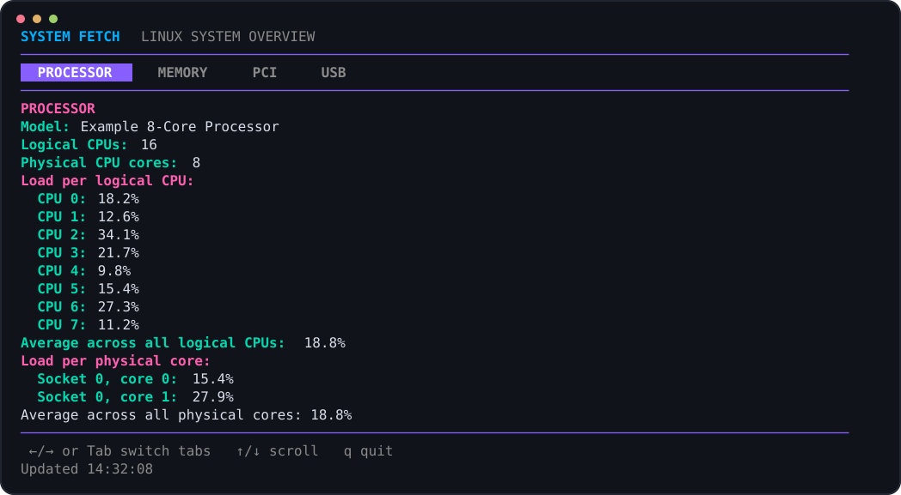
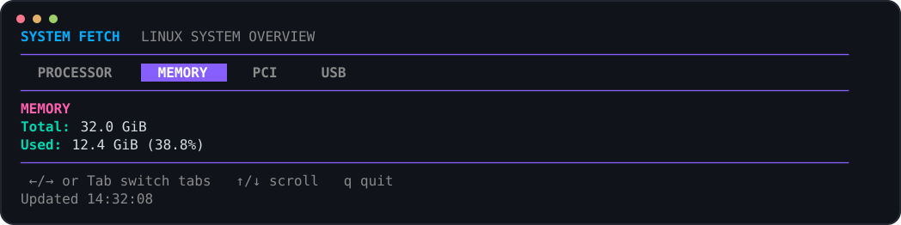
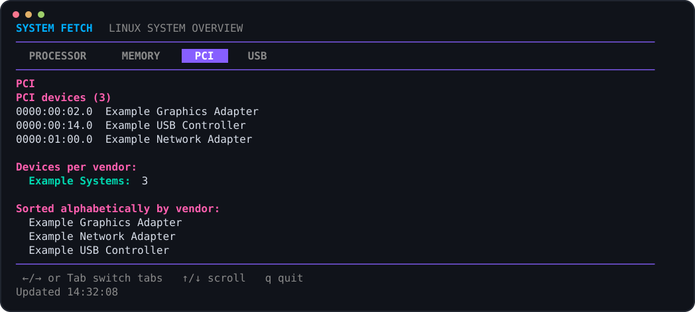
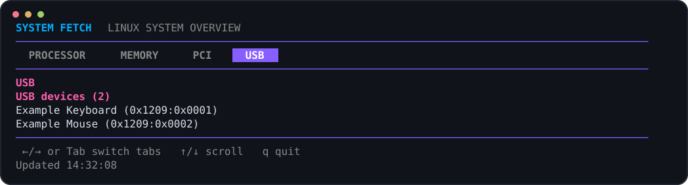
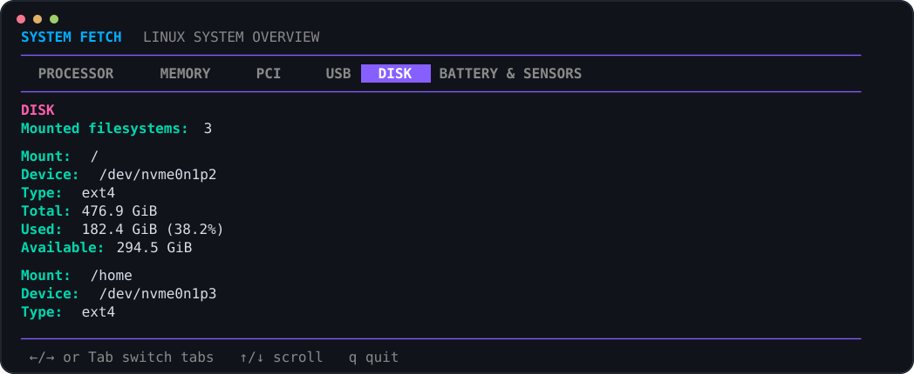

# System Fetch

System Fetch is a Java 21 command-line system information tool for Linux. It
reports processor model, logical and physical CPU counts and load, memory
usage, PCI and USB devices, and resolved hardware names when available.

## Contents

- [Requirements](#requirements)
- [Quick start](#quick-start)
- [Screenshots](#screenshots)
- [Plain-text output](#plain-text-output)
- [TUI controls and refresh](#tui-controls-and-refresh)
- [JSON export](#json-export)
- [Hardware names and platform limitations](#hardware-names-and-platform-limitations)
- [Troubleshooting](#troubleshooting)

## Requirements

- Linux, with system information exposed through `/proc` and `/sys`
- Java 21
- Maven
- An interactive terminal for the tabbed TUI

The launcher compiles the application and resolves its runtime dependencies
with Maven, so Maven and a Java 21 JDK are needed to run it. The first launch
may need network access to download Maven dependencies and, if not already
installed locally, the PCI and USB hardware ID databases.

## Quick start

From the project directory, run:

```sh
./system-fetch
```

The launcher prints `Loading system information...`, builds the application,
and forwards its arguments. It opens the TUI in an interactive terminal. If no
interactive terminal is available (or `TERM=dumb`), it prints a one-time
plain-text report instead.

## Screenshots

Screenshots below show the four TUI tabs. Values are representative examples
and are not read from a user's machine.

### Processor



### Memory



### PCI devices



### USB devices



### Disk 



## Plain-text output

Use `--plain` to print a one-time report and exit, including when running from
an interactive terminal:

```sh
./system-fetch --plain
```

## TUI controls and refresh

The TUI has Processor, Memory, PCI, and USB tabs. System information refreshes
every two seconds. Collection runs in the background so tab navigation and
scrolling remain responsive. If a refresh fails, the last successful data
remains visible and the status line reports the error.

- Left/right arrows or Tab: change tabs
- Up/down arrows: scroll
- Page Up/Page Down: scroll by a page
- Home/End: jump to the start/end
- `q` or Escape: quit

The terminal should be at least 40 columns by 7 rows. Report lines wrap to fit
the available width.

CPU utilization is calculated from successive `/proc/stat` counter samples,
roughly two seconds apart in the TUI. Each logical CPU's load is the percentage
of elapsed CPU ticks spent busy during that interval. A physical core's load
combines the tick deltas of its mapped logical CPUs (including SMT siblings);
the displayed averages are arithmetic means across the reported CPUs or
physical cores. The initial TUI sample has no prior counters, so load values
appear after the next refresh.

## JSON export

Pass `--json-file` to write a structured snapshot:

```sh
./system-fetch --json-file ./system-info.json
```

In the interactive TUI, the JSON file is refreshed every two seconds. Each
complete document is written to a temporary file beside the destination and
atomically renamed into place, so readers see the previous or next complete
snapshot rather than a partial write. The destination filesystem must support
atomic replacement. In plain-text mode, one JSON snapshot is written before
the program exits.

Combine plain-text output and JSON export:

```sh
./system-fetch --plain --json-file "./system info.json"
```

The JSON document has a `schema_version` and UTC `generated_at` timestamp, plus
processor, memory, PCI-device, and USB-device data. For example:

```json
{
  "schema_version": 1,
  "generated_at": "2026-01-01T12:00:00Z",
  "processor": {
    "model": "Example Processor",
    "logical_cpus": 2,
    "physical_cores": 1,
    "physical_topology_available": true,
    "physical_topology_complete": true,
    "logical_cpu_load_percent": [
      { "id": 0, "utilization": 10.0 },
      { "id": 1, "utilization": 15.0 }
    ],
    "average_logical_load_percent": 12.5,
    "physical_core_load_percent": [
      { "name": "Socket 0, core 0", "utilization": 12.5 }
    ],
    "average_physical_core_load_percent": 12.5
  },
  "memory": {
    "total_kib": 33554432,
    "used_kib": 12800000,
    "used_percent": 38.1
  },
  "pci_devices": [
    {
      "bus": 0,
      "device": 2,
      "function": 0,
      "vendor_id": "0x1234",
      "device_id": "0xabcd",
      "class": "030000",
      "vendor_name": "Example Vendor",
      "name": "Example Graphics Adapter"
    }
  ],
  "usb_devices": [
    {
      "vendor_id": "0x1234",
      "product_id": "0x0001",
      "vendor_name": "Example Vendor",
      "name": "Example USB Device"
    }
  ]
}
```

Load values are percentages; memory values are in KiB. In the TUI, CPU load
arrays are empty and their averages are `null` until a previous sample exists.
If physical topology is unavailable, `physical_cores` and the average physical
load are `null`, the physical-core load list is empty, and
`physical_topology_available` is `false`. Incomplete topology is marked with
`physical_topology_complete: false`; logical CPUs without topology data are
counted individually.

The default `system-info.json` output is ignored by Git. Choose another
destination if you want to keep or track an export.

## Hardware names and platform limitations

PCI and USB names are resolved using `pci.ids` and `usb.ids` databases. The
program searches the project directory, `data/`, `ids/`, `/usr/share/hwdata/`,
and `/usr/share/misc/`. If a database is missing, it tries to download and
cache it under `data/`; if that is unavailable, raw hexadecimal IDs are shown.

The collector uses Linux `/proc` and `/sys`; other operating systems are not
currently supported. CPU topology depends on information provided by Linux and
the processor architecture. If physical-core details are missing, the tool
reports that limitation and provides logical CPU load instead. In containers,
`/proc` and `/sys` may describe the host rather than the container's CPU quota,
so reported CPU counts and utilization may not match the resources available
to the container. NixOS and other Linux distributions can run the program when
Java 21, Maven, and the expected system files are available.

## Troubleshooting

- **`mvn: command not found`:** install Maven and ensure it is on `PATH`.
- **`./system-fetch: Permission denied`:** run `chmod +x system-fetch`, then
  retry.
- **Hardware names show as hexadecimal IDs:** install the matching hardware ID
  database or allow network access for the initial download.
- **Physical-core count is unavailable:** the kernel or architecture did not
  provide usable socket/core topology; logical CPU reporting remains available.
- **JSON export fails:** check that the destination directory is writable and
  that its filesystem supports atomic replacement.
